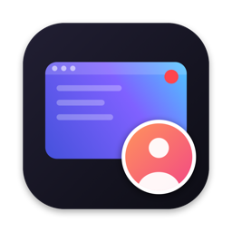
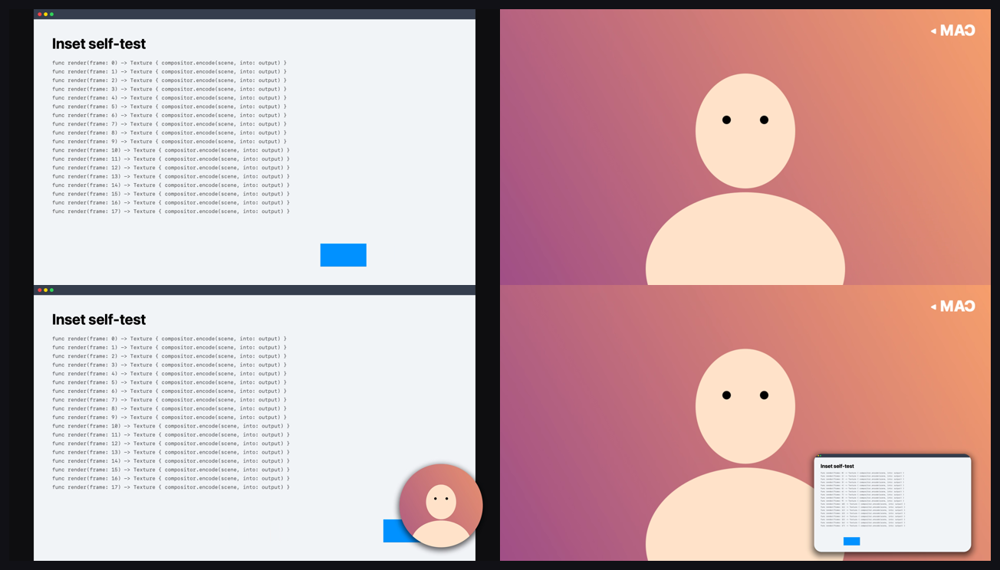
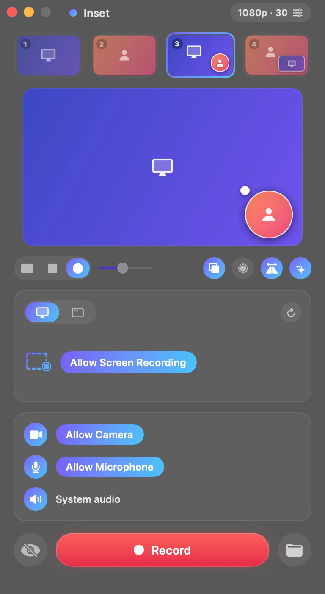

<p align="center">
  
</p>

<h1 align="center">Inset</h1>

<p align="center">
  Screen + facecam recording for macOS. Switch layouts live, move the overlay anywhere, send the result straight to your iPhone.<br>
  Native Swift · ScreenCaptureKit · Metal · Apple Silicon
</p>

<p align="center">
  
</p>

## Features

- **Four live layouts:** Screen, Camera, Screen + Camera, Camera + Screen. Switch while recording; changes glide over about 0.4 s instead of cutting.
- **Move and resize the overlay:** drag it, drag its corner dot, pinch or scroll over it, or double-click to swap. It snaps to edges and centre lines. This works in the preview window, or in the mini layout pad when the preview is closed.
- **Record a display or a single window.** Pick from live thumbnails. Window recordings follow the window when it is resized or moved.
- **Optional live preview.** It shows exactly what is being recorded, and Inset hides its own windows from the capture, so the preview never appears in the video.
- **Audio:** microphone and/or system audio, each with its own on/off switch, a choice of input device and a level meter. Both are mixed into one track so every player plays them.
- **Any camera:** built-in, USB or Continuity Camera (your iPhone). Shape options: circle, square or rectangle, with adjustable corners, shadow, border and mirroring.
- **Send to iPhone:** AirDrop the finished recording; it lands straight in the iPhone's Photos app. You can also add it to Photos on the Mac (with iCloud Photos on, it syncs to the phone), save a copy, or share it.
- **Global hotkeys** that work from any app. The same shortcuts are listed in the app's menus, and the Dock icon shows the running time while you record.
- **Light on resources:** hardware HEVC/H.264 encoding, zero-copy GPU compositing (under 1 ms per 1080p frame on an M-series chip), and screen capture at only the resolution the output needs. Nothing runs while the preview is closed and you are not recording.

<p align="center">
  
</p>

## Shortcuts

| Keys | Action |
| --- | --- |
| <kbd>⌃⌥1</kbd> – <kbd>⌃⌥4</kbd> | Screen · Camera · Screen + Camera · Camera + Screen |
| <kbd>⌃⌥S</kbd> | Swap screen and camera |
| <kbd>⌃⌥R</kbd> | Start / stop recording |
| <kbd>⌃⌥P</kbd> | Pause / resume |
| <kbd>⌃⌥V</kbd> | Show / hide preview |
| <kbd>⌘O</kbd> | Open a past recording to send or share it |
| <kbd>⌘,</kbd> | Output settings |

## Build & install

You need macOS 14 or later, an Apple Silicon Mac and Xcode 15 or later (or the Command Line Tools with Swift 5.10+).

```bash
git clone https://github.com/AlborzAbutalebi/inset.git
cd inset
./scripts/build.sh --install     # builds, signs and copies Inset.app to /Applications
```

The script signs with your Apple Development certificate if you have one, so privacy permissions survive rebuilds. Without one it signs ad-hoc, and macOS asks for permissions again after each rebuild.

On first launch, Inset asks for **Screen Recording**, **Camera** and **Microphone** access. After granting Screen Recording, macOS may need you to relaunch the app; there is a button for that in the panel.

## Sending to iPhone

When a recording finishes, the export window opens:

- **iPhone:** opens AirDrop. Pick your phone and the video goes straight into Photos.
- **Photos:** adds the video to the Mac's Photos library. With iCloud Photos on, it appears on the iPhone shortly after.
- **Save**, **Share**, **Finder** and **Delete** do what they say.

Recordings are `.mp4` files (HEVC or H.264 with AAC audio) saved to `~/Movies/Inset` by default.

## How it works

```
ScreenCaptureKit ─┐  IOSurface (zero-copy)
AVCapture camera ─┼─► FrameStore ─► RenderLoop ─► Metal compositor ─┬─► AVAssetWriter (HEVC/H.264, hardware)
                  │                 (animated layouts)               └─► Preview (CAMetalLayer)
AVCapture mic ────┼──────────────────────────────────────────────────────► AAC track ─┐
SCStream audio ───┘──────────────────────────────────────────────────────► AAC track ─┴─► post-record mixdown
```

| Path | Contents |
| --- | --- |
| `Sources/Inset/Capture` | display and window capture, camera, microphone, device lists |
| `Sources/Inset/Render` | layout maths, transition animator, Metal shaders and compositor, render loop |
| `Sources/Inset/Recording` | real-time encoder with pause support, audio mixdown |
| `Sources/Inset/UI` | SwiftUI control panel, AppKit preview window, export window |
| `Sources/Inset/App` | app model, pipeline orchestration, hotkeys, menus |

## Self-test

The self-test needs no permissions. It runs synthetic screen and camera sources through the real compositor, animator, encoder and audio mixdown, and writes a movie plus still frames:

```bash
swift build -c release && "$(swift build -c release --show-bin-path)/Inset" --selftest /tmp/inset-test
```

## License

MIT
